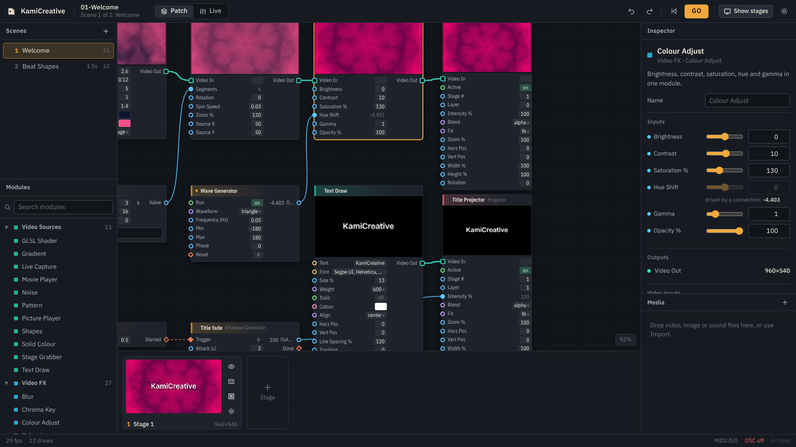
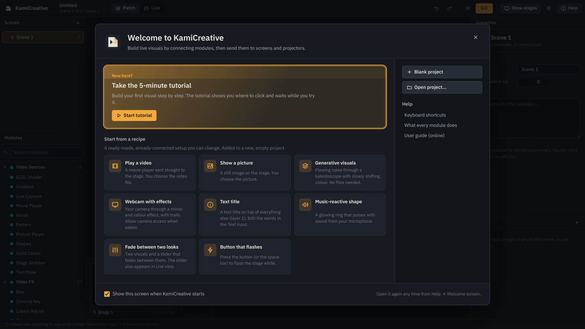
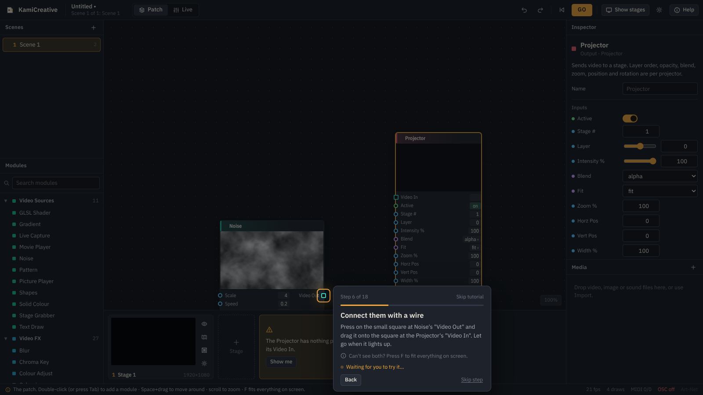
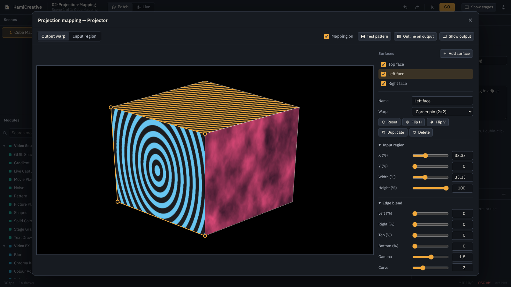
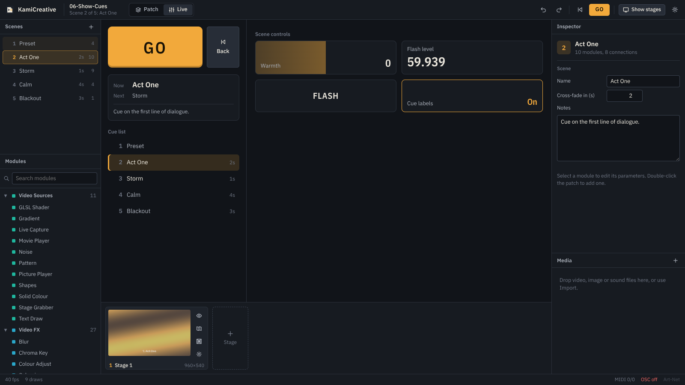

<p align="center"></p>

<h1 align="center">KamiCreative</h1>

<p align="center">A node-based, real-time media environment for live performance, interactive installations and projection mapping.</p>

<p align="center">
  <a href="https://github.com/terpenesalad/kamicreative/releases/latest"><b>Download for Windows</b></a> ·
  <a href="docs/USER_GUIDE.md">User guide</a> ·
  <a href="docs/MODULES.md">Module reference</a> ·
  <a href="CHANGELOG.md">Changelog</a>
</p>



You build a show by wiring **modules** together: movie players, cameras, generators, GPU effects, MIDI and OSC inputs, maths and logic. Every patch lives in a **scene**; scenes are your cues, and you step through them live with a GO button. Video goes out through **Projector** modules to one or more **stages**, and each stage can be warped onto real objects with the built-in projection mapper.

## Highlights

- **Easy to learn.** A five-minute interactive tutorial, a welcome screen, one-click recipes, hover help for everything on screen, and modules that wire themselves in when you add them after a selected one.
- **106 modules** across video sources, 27 GPU effects, compositing, generators, maths, logic, control surfaces, MIDI, OSC, Art-Net DMX, audio analysis and scene control.
- **Everything is live.** Values scrub with the mouse, wires connect instantly, and every video module shows its own preview while the show runs.
- **Scenes as cues.** Cross-fade between scenes, auto-follow with Scene Start + Jump to Scene, and run the show from a dedicated Live view with a big GO button, cue list, notes and operator controls.
- **Projection mapping** on every stage: any number of surfaces, perspective-correct corner pin, bicubic mesh warps up to 8×8, per-surface input regions, soft-edge blending with gamma and curve, colour trim, a calibration test pattern, and pixel nudging with the keyboard.
- **Multiple outputs.** Each stage opens as its own window and can go full screen on any connected display.
- **Show control.** MIDI notes / CC in and out, OSC receive and send over UDP, Art-Net DMX output for lighting, keyboard, mouse and gamepad input.
- **Write your own shaders** with the GLSL module, with compile errors shown on the module.
- **Built for the booth:** full undo/redo, crash recovery, atomic saves with a backup, relative media paths so projects travel, and a graphics self-test.

| Welcome screen and recipes | Interactive tutorial |
|---|---|
|  |  |

| Projection mapping | Live view |
|---|---|
|  |  |

## Install

Download **KamiCreative-Setup-1.1.0.exe** from the [latest release](https://github.com/terpenesalad/kamicreative/releases/latest) and run it. The installer lets you choose the install folder, adds Start-menu and desktop shortcuts, and registers `.kamic` project files.

Windows may show a SmartScreen prompt because the installer is not code-signed yet. Choose **More info → Run anyway**.

Requirements: Windows 10 or 11 (64-bit) and a GPU with WebGL 2 support (any graphics card or integrated GPU from the last decade). Run **Help → Graphics Self-Test** to check your system.

## Quick start

1. On the Welcome screen, click **Take the 5-minute tutorial** (or Help → Interactive tutorial later). It walks you through everything below.
2. Or pick a **recipe** for a ready-made starting point.
3. Double-click the patch (or press **Tab**) to add a module. Type to search, press Enter.
4. Drag from an output port (right side) to an input port (left side) to connect.
5. Send video to a **Projector**, then click the eye icon on the stage strip to open the output window. Double-click that window to go full screen.
6. Add scenes on the left. Press **Page Down** or the **GO** button to move through them.

The [user guide](docs/USER_GUIDE.md) covers patching, scenes, stages, mapping and show control in detail.

## Examples

| Example | Shows |
|---|---|
| Welcome | Patching basics, previews, a slider and a title that fades in on scene start |
| Projection Mapping | Three surfaces mapped onto the faces of a cube |
| Audio Reactive | Microphone analysis driving shapes, colour and glow with feedback |
| MIDI and OSC | Crossfading from a MIDI controller, OSC or an on-screen slider; keyboard blackout |
| Video Feedback | A feedback tunnel steered with an XY pad |
| Show Cues | A five-cue show with fades, an auto-follow, operator controls and notes |

## Building from source

```bash
git clone https://github.com/terpenesalad/kamicreative.git
cd kamicreative
npm install
npm start            # build the renderer and run the app
npm test             # engine, protocol and geometry tests
npm run dist:win     # build release/KamiCreative-Setup-<version>.exe
```

Node 20 or newer is required. Windows installers can be built on Windows, or on Linux with Wine installed.

### How it is put together

| Path | What lives there |
|---|---|
| `main/` | Electron main process: windows, stage displays, menus, files, OSC and Art-Net over UDP |
| `src/core/` | Engine (data flow, scenes, cross-fades), project model, expression compiler, port types |
| `src/gl/` | WebGL 2 renderer, stage compositor and projection-mapping geometry |
| `src/nodes/` | Every module, grouped by domain |
| `src/ui/` | Patch editor, inspector, panels, mapper and Live view |
| `scripts/` | Renderer bundling, example and documentation generators |
| `test/` | `node:test` suites |

Value ports push changes through the graph as they happen; video ports are pulled once per frame by Projectors, so only visible video is rendered, and a module that feeds back into itself receives its previous frame (which is what makes feedback patches possible). Stage windows share the editor's GPU context, so outputs are copied on the GPU without any frame transfer between processes.

## Licence

MIT, see [LICENSE](LICENSE). Third-party components are listed in [THIRD_PARTY_NOTICES.md](THIRD_PARTY_NOTICES.md).

KamiCreative is an independent project. It is not affiliated with or endorsed by TroikaTronix or any other vendor of media software.
